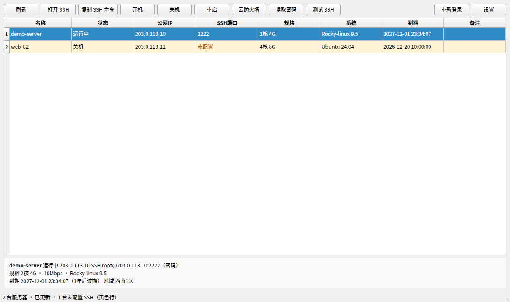
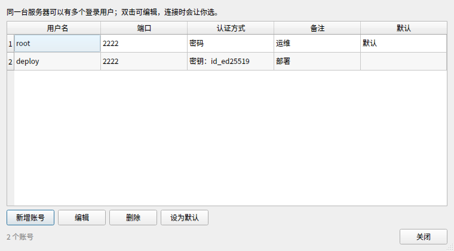
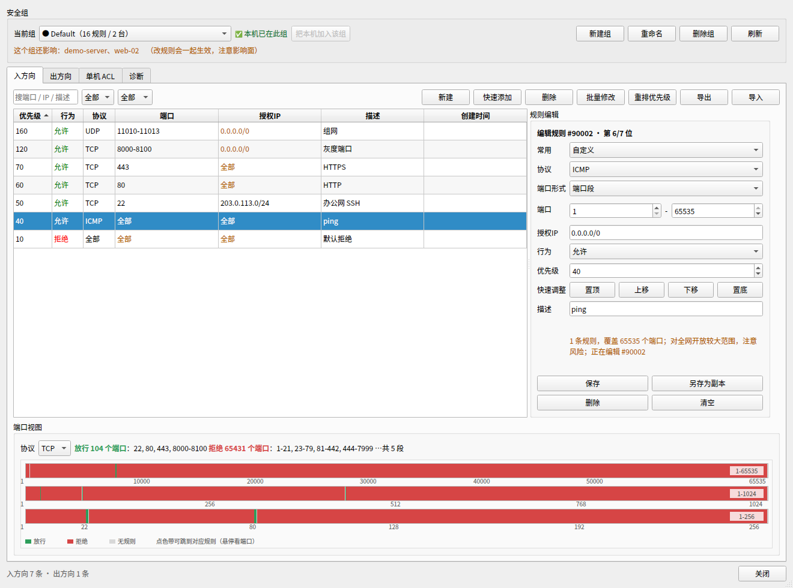
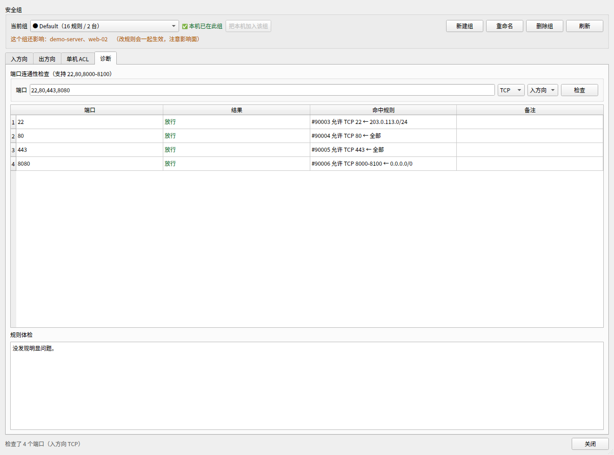

> [!WARNING]
> **非官方第三方实现（Unofficial / Third-party）**
>
> 本项目由个人开发者维护，与 **蓝队云（landui.com，云南蓝队云计算有限公司）没有任何隶属、合作或授权关系**，
> 也不是官方 SDK。所有接口均来自对公开网页前端行为的整理，随时可能变更或失效。
>
> 请只操作**你本人拥有或已获授权**的账号与服务器，并遵守蓝队云的服务条款；
> 使用本项目造成的任何直接或间接后果由使用者自行承担。
> “蓝队云 / Landui” 等名称仅用于说明兼容对象，相关商标归其权利人所有。

# LanduiSDK · 蓝队云本地运维台

把 [蓝队云控制台](https://www.landui.com/) 的网页接口抽成一个 **requests 版 SDK**，
再用 PySide6 拼一个本地小工具，实现「看一眼机器状态 → 拉起 SSH」的最短路径。

> 再次强调：这是**第三方非官方实现**，不是蓝队云官方产品。

## 能做什么

* 列出云服务器：状态、公网 IP、规格、系统、到期时间
* 读实例详情：**登录账号 / SSH 端口 / 到期信息**（就是网页「实例详情」那几项）
* 一键拉起 SSH：新开你指定的终端/Tabby/Windows Terminal，端口自动读，
  支持**密码 / 密钥 / Agent**，同一台机器可存**多个登录账号**
* 开机 / 关机；重启（蓝队云要求短信验证码，SDK 支持发码+提交）
* **云防火墙管理台**（主力功能）：规则增删改查、批量操作、常用端口预设、
  端口连通性判定、规则体检、导入导出、安全组新建/改名/绑定
* 单机 ACL 硬防：查看 / 新增 / 删除
* 顺带：快照列表、操作日志、域名/虚拟主机/租用托管/SSL 列表

## 快速开始

```bash
uv sync                        # 装 SDK 依赖
uv sync --extra gui            # 需要图形界面时
```

### 1. 拿到登录态（三选一）

**A. 从已登录的 Chrome 一键导入（推荐）**

```bash
# 先带调试端口启动一个非 headless 的 Chrome，并在里面登录蓝队云
google-chrome --remote-debugging-port=9222 \
  --user-data-dir=/tmp/landui-chrome https://www.landui.com/user/

uv run python scripts/import_cookies.py     # -> ~/.config/landui-sdk/auth.json
```

**B. 保存账号密码，让程序自己登录（长期用推荐）**

登录框默认就是「账号密码」页；验证码区域默认折叠，只有服务端明确要验证码时才展开，
点验证码图片或「换一张」都能刷新。

密码由**你自己**在弹窗或命令行里输入，程序写进
`~/.config/landui-sdk/credentials.json`（权限 0600），之后启动时自己读取；
不会回显、不会写日志、不会出现在异常信息里。

* 图形界面：登录框「账号密码」页签 →「记住账号」/「记住密码」分开勾选 → 登录
  - 只勾账号：下次预填账号，密码留空
  - 勾了密码：下次密码也预填（显示为圆点），Cookie 失效时还能静默登录
  - 两个都不勾：登录成功后清掉本地凭据
* 命令行（`getpass` 不回显，也不进 shell 历史）：

```bash
uv run landui login --credentials --save-credentials
```

登录流程和网页一致：先 `accountcheck` 探一下要不要验证码；要的话弹图片让你填 4 位字符，
再提交 `login/account`。成功后 Cookie 会保存，直到过期才需要再登。

**C. 纯环境变量**（不落盘）：`LANDUI_USERNAME` / `LANDUI_PASSWORD`，优先级高于文件。

**D. 手写 auth.json**：把浏览器 Cookie 按
`{"cookies":[{"name":"PHPSESSID","value":"...","domain":".landui.com"}]}` 存进去即可。

### 2. 命令行

```bash
uv run landui ls
uv run landui info 10001          # 含 SSH 端口
uv run landui ssh 10001           # 拉终端
uv run landui off 10001
uv run landui on 10001
uv run landui restart 10001       # 先发验证码，再 landui restart 10001 --code 123456
uv run landui fw groups
uv run landui fw rules 5192 --direction in
uv run landui fw open 5192 8080 --desc "临时测试"
uv run landui fw rm 5192 69574
```

### 3. 图形界面

```bash
uv run --extra gui python examples/app.py
```



### 一键 SSH

点「打开 SSH」或双击服务器行 → 在选定的终端里连上；有多个账号时先弹菜单选人。

**多账号**（同一台机器 root / deploy / 运维 各自保存）：

右键服务器 →「SSH 账号管理…」



* 每个账号独立设置：用户名、端口、认证方式、备注，可设默认账号
* 认证方式三选一：**密码** / **密钥**（可选私钥口令）/ **SSH Agent**
* 「测试连接」直接验证这套凭据，不用开终端
* 连不上会提示打开账号管理改凭据

**打开方式**（设置 → 打开方式）：

| 平台 | 可选 |
| --- | --- |
| Linux | 自动探测、GNOME Terminal、Konsole、Xfce、MATE、Tilix、kitty、Alacritty、WezTerm、foot、xterm、**Tabby** |
| Windows | PowerShell、PowerShell 7、Windows Terminal、命令提示符 |
| 通用 | **自定义命令模板**：`alacritty -e bash -lc {cmd}`、`tabby run bash -lc {cmd}`… |

模板占位符：`{cmd}`（完整 ssh 命令）、`{user}`、`{host}`、`{port}`、`{address}`、`{key}`。

> 密码/私钥口令通过 `SSH_ASKPASS_REQUIRE=force` 自动填，不需要 sshpass。
> 用 Tabby 时注意：`tabby run` 依赖已运行的 Tabby 实例；若客户端秒退，
> 应用会提示你换一个打开方式（本机 Wayland 下 Tabby 偶发崩溃就是这种情况）。

### 云防火墙管理台



左侧表格 + 右侧**内联编辑面板** + 底部**端口视图**，选中即改，不用来回开弹窗。

* 安全组：切换、新建、重命名、删除（需输入组名确认）、把本机加入该组；
  显示 **这个组还绑着哪些机器**，改规则前知道影响面
* 选中规则 → 右侧面板自动填充：常用端口下拉、协议、端口形式（单端口/端口段/多端口）、
  授权IP、行为、优先级、描述，全部可选可改，点「保存」立即生效
* **端口形式**三种都支持：`443`、`8000-8100`、`22,80,8000-8100`；
  范围规则可勾「拆成单端口规则」逐端口各建一条（也能对已有规则右键批量拆分）
* 快速添加：一次勾选 SSH/HTTP/HTTPS/MySQL/Redis/RDP… 批量建规则
* **改优先级**（多种顺手方式）：
  - 右侧「置顶 / 上移 / 下移 / 置底」，或 `Ctrl+↑/↓`
  - **直接拖动表格行**调整顺序（按「优先级」列排序时可用，拖完自动重算权重）
  - 「重排优先级」：整组重新编号 10/20/30…，清掉重复/稀疏/顶到 65535 的权重
  - 批量修改里也能统一设值
  - 上移/下移只交换两条规则的权重（2 次请求），不会动其他规则
* 批量修改：优先级、授权IP、行为、复制到反方向
* 双击规则 → 详情窗口；右键复制端口/IP/JSON
* 导出 / 导入 JSON；快捷键 `F5` 刷新、`Delete` 删除

**端口视图**（底部）：

* 三条色带：`1-65535` / `1-1024` / `1-256`，绿色放行、红色拒绝、灰色无规则
* 鼠标悬停看到「端口 + 命中规则 + 优先级」
* **点色带直接跳到对应规则**，并在右侧打开编辑
* 上方摘要直接写出：放行哪些端口段、拒绝哪些端口段、各多少端口



诊断页：输入 `22,80,8000-8100` 逐端口给结论；同时做规则体检
（重复、冲突、被高优先级遮蔽、对全网全端口放行）。

### 单机 ACL

和网页同款字段（权重/方向/行为/协议/远端/本地），可新增、批量删。

* 表格选中一台 → 详情栏出现 SSH 端口/规格/到期
* `打开 SSH`：新终端窗口直接连（端口自动读，密码可按需缓存到本地）
* `云防火墙`：安全组下拉 + 入/出方向规则表 + 开端口表单
* 每 20 秒自动刷新状态

本地文件（都 0600，**明文**，和浏览器记住密码同级）：

* `~/.config/landui-sdk/auth.json` — 登录态 Cookie
* `~/.config/landui-sdk/credentials.json` — 账号密码（可在设置里一键清除）
* `~/.config/landui-sdk/config.json` — 每台机器的 SSH 账号（可多个）、密码/私钥口令、备注、打开方式

## 代码里怎么用

```python
from landui_sdk import LanduiClient

c = LanduiClient.from_cookies_file()

for s in c.cloud.all_servers():
    print(s.id, s.name, s.status, s.ip)

d = c.cloud.get_server(10001)
print(d.ssh_command)          # ssh -p 2222 root@203.0.113.10
print(c.cloud.get_ssh_password(10001))

c.cloud.power_off(10001)
c.cloud.power_on(10001)

fw = c.firewall
for g in fw.list_groups():
    print(g.id, g.name, g.rule_count)
fw.add_rule(5192, port="8080", protocol="TCP", description="临时")
fw.delete_rules(5192, [69574])
```

## 已探明的接口

完整表格见 [`docs/API.md`](docs/API.md)。几个关键约定：

* 控制台是服务端渲染的 PHP 页面；列表接口返回 **HTML 片段数组**，SDK 里用正则解析。
* 带 `X-Requested-With: XMLHttpRequest` 时，有些 HTML 页面会被包成 JSON 字符串
  （`"<!DOCTYPE html>..."`），SDK 统一解包。
* 分页是 DataTables 风格：`start`（从 1 开始）、`length`、`order[0][name]`。
* 请求成功后返回 `{"status":"y"|"n","info":...}`，`status=n` 抛 `APIError`。

## 已知限制

* **重启**必须短信/邮箱验证码，无法全自动。
* 已验证写入：开机、关机、加规则、改规则、删规则（用 203.0.113.0/24 的测试规则加完再删，已恢复原状）。
* 未验证写入：新建/改名/删除安全组、单机 ACL、重装、重置密码。
* 安全组「加入实例」只有加入接口，网页也没给解绑入口，换组请到网页确认。
* 站点对登录接口有风控：**不要用脚本反复试账号密码**，会被 WAF 盯上。
* 资源监控 `getchart` 对没有装探针的机器返回空。
* 登录态会过期（`PHPSESSID` + `landuiUSER_CENTER_ACCESS_TOKEN`），
  失效时抛 `NotLoggedInError`，重新导入 Cookie 即可。

## 目录

```
landui_sdk/
  client.py     会话、Cookie 持久化、登录、请求封装
  cloud.py      云服务器：列表/详情/电源/密码/日志/快照
  firewall.py   安全组 + 单机 ACL
  account.py    域名/主机/托管/SSL/回收站 列表
  ssh.py        拼 ssh 命令、密钥/密码/Agent、各种终端与 Tabby/PowerShell
  credentials.py 账号密码本地保管（0600 / 环境变量）
  config.py     本地密码/备注存储
  cli.py        landui 命令
examples/app.py   主窗口
examples/firewall_window.py  防火墙管理台
examples/ssh_dialog.py       SSH 账号管理

examples/ui_common.py        线程池/错误提示
scripts/import_cookies.py  从 Chrome 调试端口导 Cookie
tools/cdp.py   探索期用的 CDP 抓包小工具
docs/API.md    接口清单
tests/         离线解析测试
```

## 许可与声明

* 代码：[MIT](LICENSE)
* 性质声明：[NOTICE](NOTICE) —— 本项目为**非官方第三方实现**，
  与蓝队云（landui.com）无任何隶属、合作或授权关系；
  “蓝队云 / Landui” 等名称仅用于说明兼容对象。
